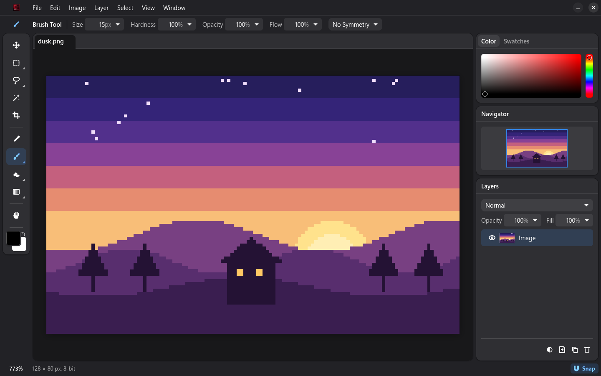

  

<h1 align="center">Crimson Pixel</h1>

A layered image editor for Linux, for pixel art, illustration and photos. 
Opens and saves <a href="https://www.adobe.com/devnet-apps/photoshop/fileformatashtml/">Photoshop files</a> with their layers.

  
  
  

  <a href="https://github.com/Crimson-Org/crimson-pixel/releases/latest"><b>Download Here!</b></a>

  

## Why

Pixel art, painting and photo work share one workspace, so one image can go through all three without leaving the app.

## About

### Layers

Layers, groups, masks and blend modes.\
Adjustment layers such as Levels and Curves change everything below them without touching a pixel.\
Photoshop files keep their layers, and PNG, JPEG, WebP and BMP work too.

### Made for pixels

The Pencil paints whole pixels, zoom keeps them square and the grid shows up close.\
Tile Preview repeats the image to check seamless textures, and Symmetry mirrors your strokes.

### Your workspace

Panels dock to any edge, and layouts save as named workspaces.\
Changed documents are backed up every few minutes, so a crash loses little.

## Building

You need a [C compiler](https://gcc.gnu.org/), [make](https://www.gnu.org/software/make/), [pkg-config](https://www.freedesktop.org/wiki/Software/pkg-config/) and the development files for [GTK4](https://gtk.org), [libadwaita](https://gnome.pages.gitlab.gnome.org/libadwaita/), libpanel and [zlib](https://zlib.net/).\
On [openSUSE](https://www.opensuse.org/) these come from `sudo zypper install gcc make pkg-config gtk4-devel libadwaita-devel libpanel-devel zlib-devel`.

Steps:
 1. Clone using `git clone --recurse-submodules https://github.com/Crimson-Org/crimson-pixel`
 2. Run `sh .crimson-build/install.sh`

`sh .crimson-build/uninstall.sh` uninstalls Crimson Pixel.
