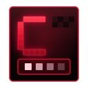

  

<h1 align="center">Crimson Pixel</h1>

A native Linux workspace for image editing, illustration and <a href="https://en.wikipedia.org/wiki/Pixel_art">pixel art</a>. 
Reads and writes layered <a href="https://www.adobe.com/devnet-apps/photoshop/fileformatashtml/">Photoshop files</a>. 
Perfect for pixel art.

  
  
  

  <a href="https://github.com/Crimson-Org/crimson-pixel/releases/latest"><b>Download Here!</b></a>

## Why

Pixel art, illustration and photo editing usually need separate programs.\
Crimson Pixel puts them in one workspace.

## Features

### Layers and adjustments

Layers, groups and masks with 27 blend modes, clipping, opacity and fill.\
Adjustment layers such as Levels, Curves and Gradient Map change everything below them without touching a pixel.\
Photoshop files open and save with layers, groups and masks, and [PNG](https://www.libpng.org/pub/png/), [JPEG](https://jpeg.org/), [WebP](https://developers.google.com/speed/webp) and [BMP](https://en.wikipedia.org/wiki/BMP_file_format) save in their own format.\
The canvas draws on the GPU from tiles, and composition uses every processor core.

### Tools made for pixels

The Pencil paints whole pixels and can drop the doubled corners of one pixel lines.\
Zoom steps keep pixel art square, a grid shows at high zoom and Tile Preview repeats the image to check seamless textures.\
Symmetry mirrors Brush, Pencil and Eraser strokes across the middle.

### A workspace you arrange

Panels dock with [libpanel](https://gitlab.gnome.org/GNOME/libpanel) and move to any edge.\
Named workspaces save from the Window menu, and the last one returns at launch.\
A background copy of each changed document is kept every five minutes, so a crash loses at most that.\
Run `crimson-pixel first.png second.psd` to open files in the running window, or `--new-window` for a separate one.\
Settings are in Edit > Preferences (Ctrl+K).

## Building

You need a [C compiler](https://gcc.gnu.org/), [make](https://www.gnu.org/software/make/), [pkg-config](https://www.freedesktop.org/wiki/Software/pkg-config/) and the development files for [GTK4](https://gtk.org) 4.14, [libadwaita](https://gnome.pages.gitlab.gnome.org/libadwaita/) 1.6, libpanel and [zlib](https://zlib.net/).\
On [openSUSE](https://www.opensuse.org/) these come from `sudo zypper install gcc make pkg-config gtk4-devel libadwaita-devel libpanel-devel zlib-devel`.

Clone it with `git clone --recurse-submodules` so the shared Crimson Core code comes along.\
`sh .crimson-build/install.sh` installs it and `sh .crimson-build/uninstall.sh` removes it.\
`sh .crimson-build/run.sh` builds and starts it, and `sh .crimson-build/archive.sh` writes a tar.gz to `dist/`.\
`sh .crimson-build/appimage.sh` writes an [AppImage](https://appimage.org/) to `dist/` on [Arch Linux](https://archlinux.org/).
